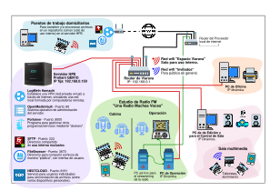

# Análisis de riesgos de la infraestructura de una radio cooperativa

## Introducción

En este laboratorio se revisa la infraestructura informática real de una radio FM comunitaria gestionada por una cooperativa de trabajo. La cooperativa adquirió un servidor HPE ProLiant MicroServer Gen10 y, con software libre, armó sobre él un NAS para compartir archivos entre los puestos de la radio, sincronizar contenidos con los puestos domiciliarios y ofrecer un repositorio de descarga a los alumnos de los cursos y talleres que se dictan en la sala multimedia.

El objetivo es identificar los componentes críticos, los elementos de protección que ya existen y los que podrían incorporarse (indicando si es viable hacerlo), analizando:

- La infraestructura de red y su arquitectura.
- Los nodos y sus sistemas operativos.
- Las aplicaciones instaladas y las posibilidades de asegurarlas.

Para cada caso se responde qué herramientas de **autenticación y autorización** se podrían implementar, qué **otras herramientas** podrían agregarse y qué **bugs o errores** conocidos pueden tener (firmware o versiones desactualizadas, configuraciones inseguras, etc.).

Como primer sondeo se utilizó la herramienta de autodiagnóstico (ADL) de INCIBE, respondiendo como si fuéramos parte de la cooperativa. Para valorar los riesgos se tomó como referencia la metodología del _Plan de Tratamiento de Riesgos de Seguridad y Privacidad de la Información_ del INFOTEP.

# Fuentes y metodología

La metodología del plan del INFOTEP (basada en la guía del DAFP/MinTIC, que toma elementos de ISO 27005 e ISO 31000) sigue estos pasos, que se aplican en forma reducida en este informe:

1. **Inventario de activos** y valoración de su criticidad.
2. **Identificación de amenazas** (deliberadas, accidentales o ambientales) y **vulnerabilidades**.
3. **Calificación del riesgo** cruzando la probabilidad de ocurrencia (rara vez, improbable, posible, probable, casi seguro) con la magnitud del impacto (insignificante, menor, moderado, mayor, catastrófico), lo que da un nivel **bajo, moderado, alto o extremo**.
4. **Tratamiento**: controles a aplicar, priorizados según el nivel de riesgo.

# Autodiagnóstico con la herramienta ADL de INCIBE

La herramienta ADL hace un cuestionario corto sobre tres dimensiones (personas, procesos y tecnología) y devuelve un nivel de riesgo y consejos para cada una. Respondi suponiendo el punto de vista de un integrante de la cooperativa, con lo que sabemos de la organización:

- No hay formación en seguridad para los integrantes ni personal de sistemas formado; la configuración la hace un integrante voluntario "por tutoriales".
- No se hacen copias de seguridad (está anotado como pendiente).
- Hay acceso remoto a los sistemas internos desde los domicilios (VPN Hamachi).
- Los integrantes usan sus notebooks y teléfonos personales para trabajar, sin una política de uso.
- Hay una sola red Wi-Fi para todos (integrantes, alumnos y visitas), con la misma contraseña.
- Existe una clave compartida entre todos los alumnos para el repositorio público (FileBrowser).
- No hay política de contraseñas ni de actualizaciones, ni un plan B si falla el servidor o la PC de streaming.
- El servicio de streaming se contrata a un tercero y no se revisaron condiciones de seguridad en el contrato.

El resultado fue **riesgo ALTO en las tres dimensiones**:

| Dimensión      | Nivel    | Consejos principales de INCIBE que aplican a la radio                                                                                                                                                                                                                                              |
| -------------- | -------- | -------------------------------------------------------------------------------------------------------------------------------------------------------------------------------------------------------------------------------------------------------------------------------------------------- |
| **Personas**   | **Alto** | Formar a los integrantes en seguridad; restringir las cuentas de administrador a personas autorizadas; planificar con cuidado los permisos del acceso remoto; establecer una política de uso de dispositivos personales (BYOD); formar al personal informático.                                    |
| **Procesos**   | **Alto** | Reglas de fortaleza y renovación de contraseñas; copias de seguridad periódicas (insiste dos veces); destrucción segura de información y soportes; ubicar servidores y routers en lugares de acceso restringido; tener un plan B; revisar las cláusulas de seguridad de los servicios contratados. |
| **Tecnología** | **Alto** | Antimalware y cortafuegos actualizados; control de acceso físico; control de acceso, monitoreo y actualización del acceso remoto; plan B para dispositivos móviles; mantener actualizados los sistemas, porque el malware ataca sistemas sin parches.                                              |

El ADL no entra en detalles técnicos, pero sirve para ver que los problemas no son solo de tecnología: la cooperativa depende de una sola persona que configura todo, no hay procedimientos (backups, altas y bajas de usuarios, actualizaciones) y no hay plan de continuidad. El resto del informe baja estos consejos a cada componente concreto.

# Relevamiento de la infraestructura

## Arquitectura de red actual

La arquitectura es una red plana detrás de dos routers en cascada (doble NAT):

Puntos a destacar:

- El servidor, las PCs de la radio, las notebooks de los integrantes y las de los **alumnos** comparten el mismo segmento `192.168.0.0/24`. La red "Invitados" del croquis todavía no está implementada.
- La PC de streaming está conectada directamente al router del proveedor, fuera de la red interna. Esto la aísla del resto (algo positivo), pero también la deja sin la protección del router interno y sin control de ancho de banda frente a los talleres.
- El acceso remoto no pasa por el router: Hamachi arma un túnel saliente desde el servidor hacia la infraestructura de LogMeIn (GoTo), así que no hay puertos abiertos hacia Internet.

## Inventario de activos y criticidad

Siguiendo la escala de valoración del plan del INFOTEP (bajo, medio, alto, muy alto, extremo) para las dimensiones de disponibilidad [D], integridad [I] y confidencialidad [C]:

| Activo                              | Tipo        | Función                                                    | D       | I        | C        | Crítico |
| ----------------------------------- | ----------- | ---------------------------------------------------------- | ------- | -------- | -------- | ------- |
| PC ad-hoc de streaming              | Hardware    | Emite la radio por Internet                                | Extremo | Alto     | Bajo     | **Sí**  |
| PC de Operación                     | Hardware    | Consola de aire de la radio                                | Extremo | Alto     | Bajo     | **Sí**  |
| Enlace a Internet y router del ISP  | Red         | Única salida a Internet; de él depende el streaming        | Extremo | Medio    | Bajo     | **Sí**  |
| Servidor HPE + disco de 1 TB        | Hardware    | Repositorio único de archivos de producción, sin respaldo  | Alto    | Muy alto | Alto     | **Sí**  |
| OpenMediaVault 6 (Debian 11)        | SO          | Sistema del servidor y su panel de administración          | Alto    | Muy alto | Alto     | **Sí**  |
| Portainer + Docker                  | Aplicación  | Gestiona los contenedores (equivale a root en el servidor) | Medio   | Muy alto | Muy alto | **Sí**  |
| Router TP-Link TL-WR940N            | Red         | Router, DHCP y Wi-Fi de toda la red interna                | Alto    | Alto     | Alto     | **Sí**  |
| Nextcloud                           | Aplicación  | Sincronización de archivos con cuentas individuales        | Medio   | Alto     | Alto     | No      |
| Samba / SFTP                        | Aplicación  | Carpetas compartidas internas                              | Alto    | Alto     | Alto     | No      |
| FileBrowser                         | Aplicación  | Repositorio público para talleres                          | Bajo    | Medio    | Bajo     | No      |
| VPN Hamachi                         | Servicio    | Acceso remoto de puestos domiciliarios                     | Medio   | Alto     | Alto     | No      |
| PCs de Oficina y Edición, notebooks | Hardware    | Producción de contenidos y administración                  | Medio   | Medio    | Medio    | No      |
| Credenciales de administración      | Información | Acceso a OMV, Portainer, routers, Hamachi, streaming       | —       | —        | Extremo  | **Sí**  |

Para una radio, el activo más importante es la **continuidad de la emisión**: el streaming y la PC de operación tienen que estar en el aire siempre. El segundo es el **servidor**, porque concentra todo el trabajo de producción en un único disco sin copia.

# Análisis por componente

## 1. Infraestructura de red

### Router del proveedor (ONT FD-HG8410C)

| Aspecto                    | Análisis                                                                                                                                                                                                                                                                                           |
| -------------------------- | -------------------------------------------------------------------------------------------------------------------------------------------------------------------------------------------------------------------------------------------------------------------------------------------------- |
| Protecciones actuales      | NAT y el firewall básico del equipo. No hay puertos abiertos hacia los servicios internos.                                                                                                                                                                                                         |
| Bugs / vulnerabilidades    | Es un equipo de marca blanca administrado por el ISP (normalmente por TR-069), así que la cooperativa no controla su firmware ni sabe qué versión tiene. Estos equipos suelen venir con credenciales de administración por defecto impresas en una etiqueta, Wi-Fi propia activa y WPS habilitado. |
| Autenticación/autorización | Cambiar la contraseña de administración (si el ISP lo permite) y desactivar la administración remota desde la WAN.                                                                                                                                                                                 |
| Otras herramientas         | Desactivar su Wi-Fi y WPS si no se usa. Pedir al ISP que lo ponga en modo **bridge** para eliminar el doble NAT y dejar que el router propio sea el único punto de control. Consultar si hay IP pública fija o si se está detrás de CGNAT (necesario para decidir la VPN).                         |
| Viabilidad                 | **Viable**, depende de una gestión con el proveedor y no tiene costo.                                                                                                                                                                                                                              |

### Router TP-Link TL-WR940N

Es el componente de red más débil y, a la vez, el que tiene más control sobre el tráfico interno.

| Aspecto                    | Análisis                                                                                                                                                                                                                                                                                                                                                                                                                                                                                                                                                                                                                                                                                            |
| -------------------------- | --------------------------------------------------------------------------------------------------------------------------------------------------------------------------------------------------------------------------------------------------------------------------------------------------------------------------------------------------------------------------------------------------------------------------------------------------------------------------------------------------------------------------------------------------------------------------------------------------------------------------------------------------------------------------------------------------- |
| Protecciones actuales      | NAT, Wi-Fi con contraseña (se asume WPA2-PSK) y firewall SPI básico.                                                                                                                                                                                                                                                                                                                                                                                                                                                                                                                                                                                                                                |
| Bugs / vulnerabilidades    | El modelo está **discontinuado (EOL)** y no recibe más firmware. Tiene vulnerabilidades públicas explotadas por botnets: **CVE-2019-6989** (desbordamiento de pila en la interfaz web, usada por variantes de Mirai) y **CVE-2023-33538** (inyección de comandos en `/userRPM/WlanNetworkRpc`), ambas en el catálogo de vulnerabilidades explotadas activamente de CISA; además **CVE-2022-24355** (ejecución de código desde la red local). Como alumnos y visitas están en la misma red, cualquiera conectado a la Wi-Fi puede atacar la interfaz de administración. No soporta WPA3 y tiene poca memoria (4 MB de flash / 32 MB de RAM), por lo que tampoco se le puede instalar OpenWrt actual. |
| Autenticación/autorización | Contraseña de administración fuerte y distinta de la de la Wi-Fi; desactivar la administración remota y WPS. El equipo soporta **WPA2-Enterprise con RADIUS**, lo que permitiría credenciales individuales para la Wi-Fi interna (con un FreeRADIUS en el servidor) en vez de una clave compartida.                                                                                                                                                                                                                                                                                                                                                                                                 |
| Otras herramientas         | Activar la red de **invitados** con la opción "permitir acceso a la red local" desactivada. Reservas DHCP para identificar los equipos de la radio.                                                                                                                                                                                                                                                                                                                                                                                                                                                                                                                                                 |
| Viabilidad                 | Las medidas de configuración son **viables ya** y sin costo. Pero el aislamiento de invitados de este router corta todo el acceso a la LAN, incluido el servidor donde está FileBrowser, así que **no alcanza** para el caso de uso de los talleres. Tampoco tiene un control de ancho de banda suficiente para proteger el streaming. La solución de fondo es **reemplazarlo** (ver propuesta).                                                                                                                                                                                                                                                                                                    |

### Red inalámbrica

| Aspecto                    | Análisis                                                                                                                                                                                                                                                                                                                                                                    |
| -------------------------- | --------------------------------------------------------------------------------------------------------------------------------------------------------------------------------------------------------------------------------------------------------------------------------------------------------------------------------------------------------------------------- |
| Protecciones actuales      | Una sola red con contraseña compartida entre integrantes, alumnos y visitas.                                                                                                                                                                                                                                                                                                |
| Bugs / vulnerabilidades    | Con WPA2-PSK, quien conoce la contraseña puede capturar el handshake de otro equipo y **descifrar su tráfico**. Como los paneles de OMV (puerto 80), Portainer (9000), FileBrowser y Nextcloud se sirven por **HTTP sin TLS**, un alumno podría ver las credenciales de administración en texto plano. Además, cualquier alumno queda a un paso de Portainer, Samba y SFTP. |
| Autenticación/autorización | Separar redes: interna con WPA2/WPA3-Enterprise (usuario por persona vía RADIUS) o al menos WPA2-PSK con una clave que solo tengan los integrantes y se rote periódicamente; red de talleres con clave por curso o portal cautivo.                                                                                                                                          |
| Otras herramientas         | Segmentación por **VLAN** con reglas de firewall entre redes, aislamiento de clientes en la red de talleres y QoS.                                                                                                                                                                                                                                                          |
| Viabilidad                 | **Viable** con un router que soporte VLAN, firewall y QoS (inversión baja).                                                                                                                                                                                                                                                                                                 |

### Acceso remoto: LogMeIn Hamachi

| Aspecto                    | Análisis                                                                                                                                                                                                                                                                                                                                                                                                                                                  |
| -------------------------- | --------------------------------------------------------------------------------------------------------------------------------------------------------------------------------------------------------------------------------------------------------------------------------------------------------------------------------------------------------------------------------------------------------------------------------------------------------- |
| Protecciones actuales      | Túnel cifrado sin abrir puertos en el router. Red protegida con contraseña de Hamachi.                                                                                                                                                                                                                                                                                                                                                                    |
| Bugs / vulnerabilidades    | Es software **privativo** y la cooperativa depende de la cuenta gratuita de un tercero (límite de 5 equipos). GoTo (dueña de LogMeIn) sufrió una intrusión en 2022 en la que se robaron copias de seguridad cifradas de varios productos, **Hamachi entre ellos**. Hamachi crea una red plana: un equipo domiciliario comprometido llega a todos los servicios del servidor. Las cuentas son de equipo, no de persona, y no hay registro de quién accede. |
| Autenticación/autorización | Autenticación por par de claves por persona y equipo, con posibilidad de revocar individualmente. Si se mantiene Hamachi: 2FA en la cuenta de LogMeIn y aprobación manual de nuevos miembros.                                                                                                                                                                                                                                                             |
| Otras herramientas         | **WireGuard** (hay plugin `openmediavault-wireguard` en omv-extras) con un DNS dinámico si la IP no es fija. Si el ISP usa CGNAT y no hay IP pública, alternativas libres como **Headscale** o **NetBird** autoalojados en un VPS barato, o ZeroTier. En todos los casos, limitar por firewall a qué servicios llega la VPN (Samba, SFTP, Nextcloud; nunca Portainer ni el panel de OMV salvo el administrador).                                          |
| Viabilidad                 | **Viable** y cumple el deseo de la cooperativa de no depender de una empresa y no tener límite de cuentas. WireGuard es gratis; requiere abrir un único puerto UDP.                                                                                                                                                                                                                                                                                       |

## 2. Nodos y sistemas operativos

### Servidor HPE ProLiant MicroServer Gen10 (hardware y firmware)

| Aspecto                    | Análisis                                                                                                                                                                                                                                                                                                                                                                                                                                                                                                                                                                                                                                                                                                                   |
| -------------------------- | -------------------------------------------------------------------------------------------------------------------------------------------------------------------------------------------------------------------------------------------------------------------------------------------------------------------------------------------------------------------------------------------------------------------------------------------------------------------------------------------------------------------------------------------------------------------------------------------------------------------------------------------------------------------------------------------------------------------------- |
| Protecciones actuales      | Ninguna específica. SSD de 256 GB para el sistema y un disco de 1 TB para datos.                                                                                                                                                                                                                                                                                                                                                                                                                                                                                                                                                                                                                                           |
| Bugs / vulnerabilidades    | El **System ROM (BIOS/UEFI)** probablemente es el de fábrica; HPE publicó actualizaciones para las vulnerabilidades de ejecución especulativa del procesador AMD Opteron X3000 (familia Spectre). El disco de datos es **único y sin redundancia**: si falla, se pierde todo. Además conserva **restos de una instalación vieja de Ubuntu/Nextcloud** que nadie limpió (datos y quizás credenciales o bases de datos antiguas). No se conoce la ubicación física: si está en un lugar de paso, cualquiera puede desconectarlo o llevarse los discos, que no están cifrados. A diferencia de la Gen10 Plus, este modelo **no tiene iLO**, así que no hay una interfaz de administración remota fuera de banda que proteger. |
| Autenticación/autorización | Contraseña de BIOS/UEFI, deshabilitar el arranque desde USB/red y activar Secure Boot si la instalación lo admite.                                                                                                                                                                                                                                                                                                                                                                                                                                                                                                                                                                                                         |
| Otras herramientas         | Actualizar el System ROM con el paquete de HPE. **Segundo disco** en las bahías libres (tiene 4) para un espejo RAID1 (la cooperativa ya lo tenía previsto, aunque RAID no es backup). **UPS** con apagado ordenado. Ubicar el servidor y los routers en un lugar con llave. Monitoreo SMART con avisos por correo (OMV lo trae). Cifrado del disco de datos con LUKS (plugin `openmediavault-luksencryption`). Borrado seguro de los restos de la instalación anterior y, cuando se descarten discos, destrucción o borrado seguro.                                                                                                                                                                                       |
| Viabilidad                 | **Viable**. Lo más caro es el disco extra y la UPS, que son inversiones bajas frente al valor de lo que protegen. El cifrado del disco es viable pero agrega complejidad (hay que ingresar la clave al reiniciar), así que lo dejamos como opcional.                                                                                                                                                                                                                                                                                                                                                                                                                                                                       |

### OpenMediaVault 6 sobre Debian 11

| Aspecto                    | Análisis                                                                                                                                                                                                                                                                                                                                                                                                                                                                                                                                         |
| -------------------------- | ------------------------------------------------------------------------------------------------------------------------------------------------------------------------------------------------------------------------------------------------------------------------------------------------------------------------------------------------------------------------------------------------------------------------------------------------------------------------------------------------------------------------------------------------ |
| Protecciones actuales      | Usuarios y permisos por carpeta compartida de OMV, firewall disponible (no configurado).                                                                                                                                                                                                                                                                                                                                                                                                                                                         |
| Bugs / vulnerabilidades    | **OMV 6 está fuera de soporte** desde que salió OMV 7 (marzo de 2024), y Debian 11 "Bullseye" terminó el soporte de seguridad regular en agosto de 2024 y el **soporte LTS el 31 de agosto de 2026**. Hoy el sistema operativo del servidor **ya no recibe parches de seguridad**: el kernel, OpenSSH, Samba y las bibliotecas van a ir acumulando vulnerabilidades sin corregir. El panel web se sirve por **HTTP en el puerto 80**, y si no se cambió, el usuario de administración es `admin` con la contraseña por defecto `openmediavault`. |
| Autenticación/autorización | Cambiar la contraseña de `admin` (o reemplazarlo por un administrador con otro nombre), **HTTPS** en el panel con certificado propio, permitir el panel solo desde la red de administración. SSH solo con **claves**, sin login de root por contraseña y con **2FA TOTP** (ver el trabajo de 2FA y fail2ban). Cuentas de usuario individuales, nunca compartidas, organizadas en grupos (producción, oficina, administración) con permisos mínimos por carpeta.                                                                                  |
| Otras herramientas         | Actualizar a **OMV 7 (Debian 12) o a la versión actual** de OMV. Activar las actualizaciones de seguridad automáticas (`unattended-upgrades`). **Firewall** del propio OMV permitiendo cada puerto solo desde la red que lo necesita. **fail2ban** para el panel y SSH. Auditoría periódica con **Lynis** y escaneos con **OpenVAS** (ver el trabajo de detección de vulnerabilidades). Notificaciones por correo de OMV para fallas de disco, actualizaciones y logins. Sincronización horaria con NTP para que los logs sean confiables.       |
| Viabilidad                 | **Viable**. La actualización de versión es la tarea más delicada: hay que hacerla con un backup previo y en un horario sin talleres. El resto son configuraciones del panel de OMV.                                                                                                                                                                                                                                                                                                                                                              |

### Puestos de trabajo y dispositivos de usuario

La documentación no indica el sistema operativo de las PCs de la radio, así que las recomendaciones se plantean para Windows (lo más habitual en puestos de edición y oficina) y valen en su equivalente para GNU/Linux. Todas las PCs reciben IP por DHCP.

| Equipo                           | Riesgos                                                                                                                                                     | Medidas                                                                                                                                                                                                                                                                                    |
| -------------------------------- | ----------------------------------------------------------------------------------------------------------------------------------------------------------- | ------------------------------------------------------------------------------------------------------------------------------------------------------------------------------------------------------------------------------------------------------------------------------------------ |
| PC ad-hoc de streaming           | Punto único de falla de la emisión. Si se usa también para navegar, cualquier malware afecta al aire. Recibe solo el ancho de banda que dejen los talleres. | Uso exclusivo para streaming (sin navegación ni correo), usuario sin privilegios, actualizaciones en horarios de baja audiencia, UPS, **QoS que reserve el ancho de banda del stream**, credenciales del servidor de streaming guardadas solo en ese equipo y en un gestor de contraseñas. |
| PC de Operación                  | Crítica para la emisión; si está en la misma red que los alumnos, puede ser atacada desde ellos.                                                            | En la red interna, nunca accesible desde la red de talleres. Antivirus integrado (Defender o equivalente) activo, usuario estándar, actualizaciones automáticas.                                                                                                                           |
| PCs de Oficina y Edición/Sala    | La PC de la sala multimedia la usan talleristas externos. Riesgo de malware por pendrives, adjuntos y software descargado.                                  | Cuentas separadas para integrantes y talleristas, cuenta de invitado limitada en la PC de la sala, antivirus, deshabilitar ejecución automática de USB, lista blanca de aplicaciones (AppLocker / Smart App Control) en la PC de la sala.                                                  |
| Notebooks y celulares personales | BYOD sin política: equipos sin actualizar, sin bloqueo de pantalla, que se pierden o se los roban con acceso a la VPN y al Nextcloud.                       | Política BYOD escrita y comunicada (como pide el ADL): bloqueo con PIN, cifrado de disco, actualizaciones al día, revocar la VPN y las sesiones de Nextcloud ante una pérdida.                                                                                                             |
| Puestos domiciliarios            | Equipos fuera de control de la cooperativa con acceso a toda la LAN por la VPN.                                                                             | Acceso por VPN con clave por persona y permisos limitados por firewall; cuenta individual de Nextcloud con 2FA.                                                                                                                                                                            |

## 3. Aplicaciones instaladas

| Aplicación (puerto)       | Bugs / problemas conocidos                                                                                                                                                                                                                                                                                                                                                                                           | Autenticación y autorización                                                                                                                                       | Otras herramientas                                                                                                                                                                                                                          | Viabilidad                                                                                                                      |
| ------------------------- | -------------------------------------------------------------------------------------------------------------------------------------------------------------------------------------------------------------------------------------------------------------------------------------------------------------------------------------------------------------------------------------------------------------------- | ------------------------------------------------------------------------------------------------------------------------------------------------------------------ | ------------------------------------------------------------------------------------------------------------------------------------------------------------------------------------------------------------------------------------------- | ------------------------------------------------------------------------------------------------------------------------------- |
| **Panel de OMV** (80)     | HTTP sin cifrar; credenciales por defecto conocidas (`admin` / `openmediavault`); versión sin soporte.                                                                                                                                                                                                                                                                                                               | Contraseña fuerte, HTTPS, acceso solo desde la red de administración.                                                                                              | fail2ban, firewall.                                                                                                                                                                                                                         | Viable                                                                                                                          |
| **Portainer** (9000)      | El puerto 9000 es el acceso **HTTP heredado** (desde la versión 2.9 el predeterminado es HTTPS en 9443). Portainer controla el socket de Docker: quien entra a Portainer puede montar el sistema de archivos del host en un contenedor y es **root del servidor**. Hoy es alcanzable desde la Wi-Fi de los alumnos. Es el **riesgo más grave** de la instalación.                                                    | Contraseña larga, un solo administrador, acceso **solo desde la red de administración o por VPN**. Mejor aún: cerrar el puerto y abrirlo solo cuando se va a usar. | Usar 9443 (HTTPS) y cerrar 9000; actualizar la imagen; **Diun** o Watchtower en modo solo notificación para saber cuándo hay imágenes nuevas.                                                                                               | Viable, no tiene costo                                                                                                          |
| **Samba** (445)           | Depende de la versión de Debian 11 (sin parches). Si hay recursos con acceso de invitado, cualquiera en la red puede leer o borrar archivos.                                                                                                                                                                                                                                                                         | Usuarios individuales de OMV, sin acceso de invitado; permisos de solo lectura donde alcance; protocolo mínimo SMB2/SMB3 (SMB1 deshabilitado).                     | **Papelera de reciclaje** de Samba y **snapshots** periódicos para recuperar archivos borrados o cifrados por ransomware desde un puesto infectado; antivirus **ClamAV** (plugin de OMV) para los archivos compartidos con puestos Windows. | Viable                                                                                                                          |
| **SFTP** (222)            | Expuesto a toda la red; contraseñas susceptibles de fuerza bruta.                                                                                                                                                                                                                                                                                                                                                    | Autenticación por **claves**, usuarios enjaulados (chroot) en su carpeta.                                                                                          | fail2ban.                                                                                                                                                                                                                                   | Viable                                                                                                                          |
| **FileBrowser** (3670)    | Un **mismo usuario y contraseña para todos los alumnos**: no hay trazabilidad, la clave circula libremente y no se puede revocar a una persona. Por HTTP. El proyecto tuvo vulnerabilidades como CSRF que permitía crear cuentas (CVE-2021-46398) y en 2025 se publicaron varios avisos, entre ellos sobre la función de **ejecutar comandos** en el servidor. El propio proyecto pasó a modo de solo mantenimiento. | Usuario de alumnos de **solo lectura**, sin permisos de ejecución de comandos, subida ni borrado; clave distinta por curso que se cambia al terminar.              | Exponerlo solo a la red de talleres, y nunca a Internet. **Alternativa**: reemplazarlo por **enlaces públicos de Nextcloud** de solo lectura, con contraseña y fecha de vencimiento por curso, eliminando un servicio entero.               | Viable                                                                                                                          |
| **Nextcloud** (8181)      | Aplicación grande con parches de seguridad frecuentes; por HTTP los clientes de sincronización envían las credenciales sin cifrar. Corre en Docker y hay que actualizar la imagen a mano.                                                                                                                                                                                                                            | **2FA TOTP** (app oficial), protección contra fuerza bruta (incluida), política de contraseñas, cuentas individuales y carpetas compartidas por grupo.             | Reverse proxy con **HTTPS**, el **escáner de seguridad de Nextcloud** (scan.nextcloud.com) si algún día se publica, panel de "Advertencias de seguridad" de la administración, cifrado del lado del servidor (opcional).                    | Viable                                                                                                                          |
| **Streaming** (PC ad-hoc) | La cooperativa quiere moverlo al servidor agregando una placa de sonido. Eso concentra en un solo equipo la emisión y el almacenamiento: una actualización fallida o un ataque al NAS sacaría a la radio del aire.                                                                                                                                                                                                   | Credenciales del servicio externo de streaming solo en el equipo emisor.                                                                                           | Mantener el streaming en un equipo dedicado y con prioridad de tráfico.                                                                                                                                                                     | **No recomendable** moverlo al servidor; sí es viable mantener una segunda PC o notebook preparada como respaldo del streaming. |

### Autenticación centralizada

Hoy cada servicio tiene sus propios usuarios (OMV, Nextcloud, FileBrowser, Portainer, Hamachi). Con la cantidad de integrantes de la cooperativa, cada alta o baja implica tocar varios sistemas, y lo normal es que alguien se olvide. Las opciones son:

- **Usar los usuarios de OMV como fuente única**: Samba y SFTP ya los usan, y Nextcloud se puede conectar a un directorio **LDAP** (OMV tiene plugin de OpenLDAP) para que el usuario y la contraseña sean los mismos.
- **SSO con 2FA** delante de las aplicaciones web (Authelia o Authentik detrás de un reverse proxy).

La primera es **viable** y suficiente. La segunda es técnicamente posible, pero para una cooperativa sin personal especializado agrega más complejidad que seguridad, así que **no la consideramos viable por ahora**.

# Matriz de riesgos

Siguiendo la calificación del plan del INFOTEP (probabilidad × impacto):

| #   | Riesgo                                                                                                   | Probabilidad | Impacto      | Nivel        |
| --- | -------------------------------------------------------------------------------------------------------- | ------------ | ------------ | ------------ |
| R1  | Pérdida total de los archivos por falla del disco de 1 TB o ransomware (no hay backup)                   | Probable     | Catastrófico | **Extremo**  |
| R2  | Toma de control del servidor desde la Wi-Fi compartida vía Portainer/OMV por HTTP y credenciales débiles | Posible      | Catastrófico | **Extremo**  |
| R3  | Corte de la emisión por saturación del ancho de banda durante los talleres                               | Casi seguro  | Moderado     | **Alto**     |
| R4  | Explotación de vulnerabilidades conocidas del TL-WR940N (EOL) por botnets o usuarios de la red           | Posible      | Mayor        | **Alto**     |
| R5  | Explotación de vulnerabilidades del sistema operativo sin soporte (OMV 6 / Debian 11)                    | Probable     | Mayor        | **Extremo**  |
| R6  | Acceso indebido a través de la VPN desde un equipo domiciliario comprometido o perdido                   | Posible      | Mayor        | **Alto**     |
| R7  | Filtración o abuso de la clave compartida de FileBrowser                                                 | Probable     | Menor        | **Moderado** |
| R8  | Falla de la PC de streaming sin equipo de reemplazo                                                      | Posible      | Mayor        | **Alto**     |
| R9  | Manipulación física o robo del servidor o los routers                                                    | Improbable   | Mayor        | **Moderado** |
| R10 | Dependencia de una sola persona que conoce y administra todo (sin documentación)                         | Probable     | Mayor        | **Alto**     |

# Propuesta de mejoras

## Arquitectura propuesta

Reemplazar el TL-WR940N por un router que soporte VLAN, firewall entre redes y QoS: por ejemplo un MikroTik hEX/hAP o un equipo compatible con OpenWrt actual (con al menos 128 MB de RAM) más un punto de acceso que maneje varias redes. Con eso se arman tres redes:

VLAN 10: Interna Servidor, PCs de oficina y edición, notebooks de integrantes (Con WPA2/3 Enterprise o clave propia)

VLAN 20: Talleres Wi-Fi "Invitados" alumnos y visitas aislamiento de clientes solo llega a:

- Internet
- Servidor: solamente para lectura (File browser o Nextcloud)

VLAN 30: Emisión PC de streaming PC de Operación prioridad máxima de ancho de banda

Esto resuelve con un solo equipo tres requisitos de la cooperativa (las dos redes Wi-Fi, el control del ancho de banda de los talleres y el reemplazo de Hamachi) y los riesgos R2, R3, R4 y R6.

## Plan priorizado

| Prioridad     | Acción                                                                                                                                                                               | Riesgos        | Costo      | Viable                                                                  |
| ------------- | ------------------------------------------------------------------------------------------------------------------------------------------------------------------------------------ | -------------- | ---------- | ----------------------------------------------------------------------- |
| Inmediata     | Cambiar todas las contraseñas por defecto (OMV, routers, Portainer) y guardarlas en un gestor de contraseñas compartido (KeePassXC o Bitwarden/Vaultwarden)                          | R2, R4         | Nulo       | Sí                                                                      |
| Inmediata     | Primer **backup** completo del disco de 1 TB a un disco externo, guardado fuera del edificio                                                                                         | R1             | Bajo       | Sí                                                                      |
| Inmediata     | Activar el firewall de OMV: Portainer y panel de OMV solo desde la PC del administrador; desactivar WPS y la administración remota de los routers                                    | R2, R4         | Nulo       | Sí                                                                      |
| Inmediata     | FileBrowser en solo lectura, sin ejecución de comandos, con clave por curso                                                                                                          | R7             | Nulo       | Sí                                                                      |
| Corto plazo   | Backups automáticos con **BorgBackup** o **rsnapshot** (plugins de OMV) siguiendo la regla **3-2-1**: disco interno adicional + disco externo rotado + copia cifrada fuera del sitio | R1             | Bajo       | Sí                                                                      |
| Corto plazo   | Actualizar a OMV 7 o a la versión actual con soporte; activar actualizaciones automáticas de seguridad                                                                               | R5             | Nulo       | Sí                                                                      |
| Corto plazo   | HTTPS en todas las aplicaciones web con un reverse proxy (Nginx Proxy Manager o Caddy)                                                                                               | R2             | Nulo       | Sí                                                                      |
| Corto plazo   | 2FA en Nextcloud y SSH, SSH y SFTP solo con claves, fail2ban                                                                                                                         | R2, R6         | Nulo       | Sí                                                                      |
| Corto plazo   | Limpiar los restos de la instalación anterior de Ubuntu/Nextcloud del disco de datos                                                                                                 | R2             | Nulo       | Sí                                                                      |
| Mediano plazo | Router nuevo con VLAN, QoS y WireGuard; reemplazo de Hamachi                                                                                                                         | R2, R3, R4, R6 | Medio      | Sí                                                                      |
| Mediano plazo | Segundo disco en RAID1, UPS y ubicación del servidor bajo llave                                                                                                                      | R1, R9         | Medio      | Sí                                                                      |
| Mediano plazo | Equipo de respaldo configurado para el streaming                                                                                                                                     | R8             | Bajo/Medio | Sí                                                                      |
| Mediano plazo | Integrar Nextcloud con el LDAP de OMV para tener un usuario único por persona                                                                                                        | R6, R7         | Nulo       | Sí                                                                      |
| Continuo      | Documentar la infraestructura y los procedimientos (altas/bajas, backup, restauración, actualizaciones) y capacitar al menos a una segunda persona                                   | R10            | Nulo       | Sí                                                                      |
| Continuo      | Capacitación básica en seguridad para los integrantes (phishing, contraseñas, dispositivos personales) y política BYOD                                                               | R6, R10        | Nulo       | Sí                                                                      |
| Continuo      | Auditoría trimestral con Lynis y OpenVAS; probar la restauración de los backups                                                                                                      | R1, R5         | Nulo       | Sí                                                                      |
| Descartado    | Mover el streaming al servidor                                                                                                                                                       | —              | —          | No: concentra la emisión y el almacenamiento en un único punto de falla |
| Descartado    | SSO con Authelia/Authentik                                                                                                                                                           | —              | —          | No por ahora: complejidad excesiva para el equipo actual                |

# Conclusión

El diagnóstico con la herramienta de INCIBE dio **riesgo alto en personas, procesos y tecnología**, y el análisis técnico lo confirma. La cooperativa logró armar con software libre y poco presupuesto una infraestructura que cumple lo que necesita, pero se pensó en términos de funcionalidad y no de seguridad. Los problemas más graves no requieren ataques sofisticados:

- **No hay copias de seguridad**: un solo disco guarda todo el trabajo de producción. Es el riesgo más probable y el de mayor impacto, y su solución es barata.
- **La red es plana**: alumnos y visitas comparten la red con el servidor, cuyos paneles de administración (OMV y sobre todo Portainer, que equivale a ser root) se sirven por HTTP. La contraseña de la Wi-Fi alcanza para llegar a ellos o para leer las credenciales que pasan por el aire.
- **Los equipos centrales están fuera de soporte**: el router TP-Link es EOL y tiene vulnerabilidades explotadas por botnets, y OpenMediaVault 6 sobre Debian 11 ya no recibe parches.

La mayoría de las mejoras propuestas no cuestan dinero: cambiar contraseñas, activar el firewall, usar HTTPS, 2FA y claves SSH, actualizar el sistema y empezar a hacer backups. Las que sí requieren inversión, un router que separe las redes y priorice el streaming, un segundo disco y una UPS, son bajas y además resuelven necesidades que la cooperativa ya tenía planteadas (las dos redes Wi-Fi, el control del ancho de banda durante los talleres y salir de Hamachi). Lo que no recomendamos es concentrar más funciones en el servidor, como el streaming, porque para una radio estar en el aire es lo primero.

Por último, como muestra el resultado en la dimensión de personas, la seguridad de la radio hoy depende de una única persona. Documentar la instalación y formar a una segunda persona es tan importante como cualquier control técnico.

# Referencias

1. INCIBE. _Herramienta de autodiagnóstico (ADL)_. https://adl.incibe.es/ (resultados: consejos para nivel alto de riesgo en Personas, Procesos y Tecnología).
2. INFOTEP. _Metodología y plan de tratamiento del Riesgo de seguridad y privacidad de la información_. San Juan del Cesar, enero de 2026.
3. Cooperativa de trabajo (anonimizada). _Propuesta para servidor HPE ProLiant Gen10_ y croquis de red. Octubre de 2023.
4. HPE. _HPE ProLiant MicroServer Gen10 – QuickSpecs_. https://www.hpe.com/psnow/doc/a00008701enw
5. OpenMediaVault. _Documentación y ciclo de versiones_. https://docs.openmediavault.org/
6. Debian. _Debian LTS_. https://wiki.debian.org/LTS
7. TP-Link. _TL-WR940N_. https://www.tp-link.com/ar/home-networking/wifi-router/tl-wr940n/
8. CISA. _Known Exploited Vulnerabilities Catalog_ (CVE-2019-6989, CVE-2023-33538). https://www.cisa.gov/known-exploited-vulnerabilities-catalog
9. NIST NVD. _CVE-2022-24355: TP-Link TL-WR940N_. https://nvd.nist.gov/vuln/detail/CVE-2022-24355
10. GoTo. _Update on recent security incident_. Enero de 2023.
11. Portainer. _Documentación de instalación_. https://docs.portainer.io/
12. Nextcloud. _Hardening and security guidance_. https://docs.nextcloud.com/server/latest/admin_manual/installation/harden_server.html
13. WireGuard. https://www.wireguard.com/
